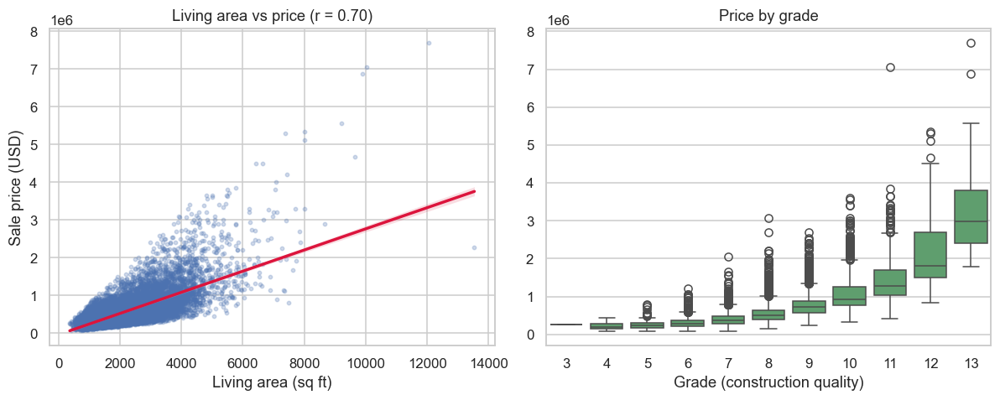

# What Drives House Prices in King County?

An end-to-end analysis of 21,597 house sales in King County, Washington, from
data cleaning to regression models evaluated on a held-out test set.

## The question

How much of a house's sale price can be explained by its physical attributes and
its location, and which attributes matter most?

## Dataset

| Item | Detail |
| --- | --- |
| Source | Kaggle, *House Sales in King County, USA* (`harlfoxem/housesalesprediction`) |
| Download | IBM Skills Network public mirror: `kc_house_data_NaN.csv` |
| Coverage | May 2014 to May 2015, King County, Washington (includes Seattle) |
| Size | 21,613 rows x 21 columns |
| Target | `price`, in US dollars |

Notes on source and permissions:

- The dataset is publicly distributed for educational use. It is used here for a
  non-commercial, educational analysis.
- The CSV is **not** redistributed in this repository. The notebook downloads it
  from the public URL at run time, so no third-party data is copied here.
- 23 cells in `bedrooms` and `bathrooms` are missing; the 16 affected rows are
  dropped, leaving 21,597 sales.
- The repository contains no personal data, passwords, API keys or restricted
  material.

## Methods and tools

- **Language and libraries:** Python 3, pandas, NumPy, matplotlib, seaborn,
  scikit-learn, Jupyter.
- **Pipeline:** load the CSV, drop the identifier column, parse the sale date,
  drop incomplete rows, describe and correlate the numeric attributes, then plot
  the relationships that matter.
- **Models:** a single-feature linear regression as a baseline, a linear
  regression on eleven attributes, a Ridge regression (`alpha = 0.1`) and a
  degree-2 polynomial Ridge regression. The last two are trained on 85% of the
  rows and scored on the remaining 15% (`random_state = 1`).

## Key findings

1. **Living area is the strongest single signal** (r = 0.70). On its own it
   explains 49% of the variance in price (R2 = 0.493).
2. **Waterfront status carries a large premium.** Only 163 of 21,597 sales are
   waterfront properties, but their median price is 1,400,000 USD against
   450,000 USD for the rest, a 3.1x difference.
3. **Grade separates the market cleanly.** Median price rises from about 375,000
   USD at grade 7 to 914,000 USD at grade 10 and 1,284,000 USD at grade 11.
4. **Eleven attributes reach R2 = 0.658 in-sample** and R2 = 0.674 on the
   held-out test set with Ridge.
5. **The degree-2 polynomial model adds little.** It reaches R2 = 0.688 on the
   test set while expanding eleven features into 77, which points to overfitting
   rather than a real improvement.




## One limitation

The analysis is observational and covers a single county in 2014-2015. It shows
association, not causation: the size variables (`sqft_living`, `sqft_above`,
`grade`) overlap heavily, so no single coefficient can be read as "the effect of
one extra square foot". Prices are not adjusted for inflation, the handful of
sales above 3 million USD dominate the squared error, and the ridge strength and
polynomial degree were fixed by hand rather than tuned with cross-validation.
The model also ignores sale date, renovation quality, school district and other
factors that buyers clearly pay for.

## How to run

```bash
python -m venv .venv
# Windows
.venv\Scripts\activate
# macOS or Linux
source .venv/bin/activate

pip install -r requirements.txt
jupyter notebook house_price_analysis.ipynb
```

Run all cells. The data is downloaded automatically and the four figures are
written to `images/`. A full run takes about 30 seconds on a laptop.

## Repository layout

```
house_price_analysis.ipynb   the analysis, with outputs
requirements.txt             pinned library requirements
README.md                    this file
images/
  fig1_correlation_with_price.png
  fig2_waterfront_price.png
  fig3_size_and_grade.png
  fig4_predicted_vs_actual.png
```

## Background

The dataset and the starting question come from a course assignment. The
notebook, the figures and the documentation here were rewritten from scratch and
extended with the model comparison and the prediction plot.

## What I would do next

- Add cross-validation and a naive baseline (for example, predicting the median
  price) so every R2 has a reference point.
- Examine residuals instead of reporting a single score, and treat the extreme
  prices that dominate the error.
- Replace the count-based grade and view columns with their documented meanings.
- Add a small map of price by latitude and longitude to test the location effect
  properly.
